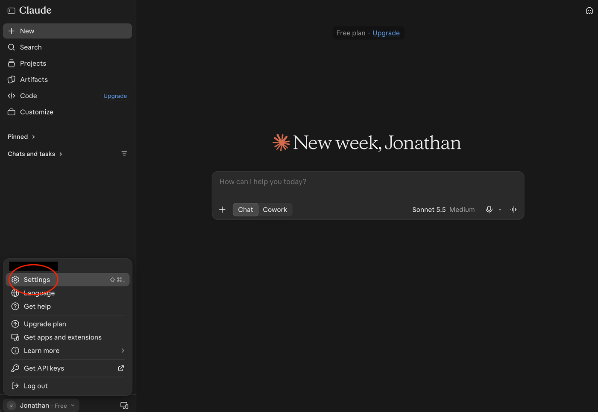
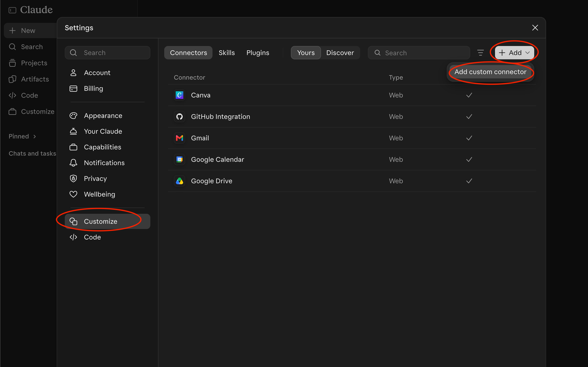
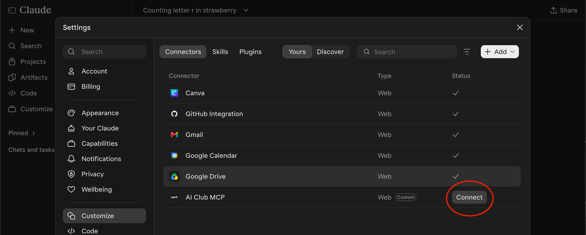
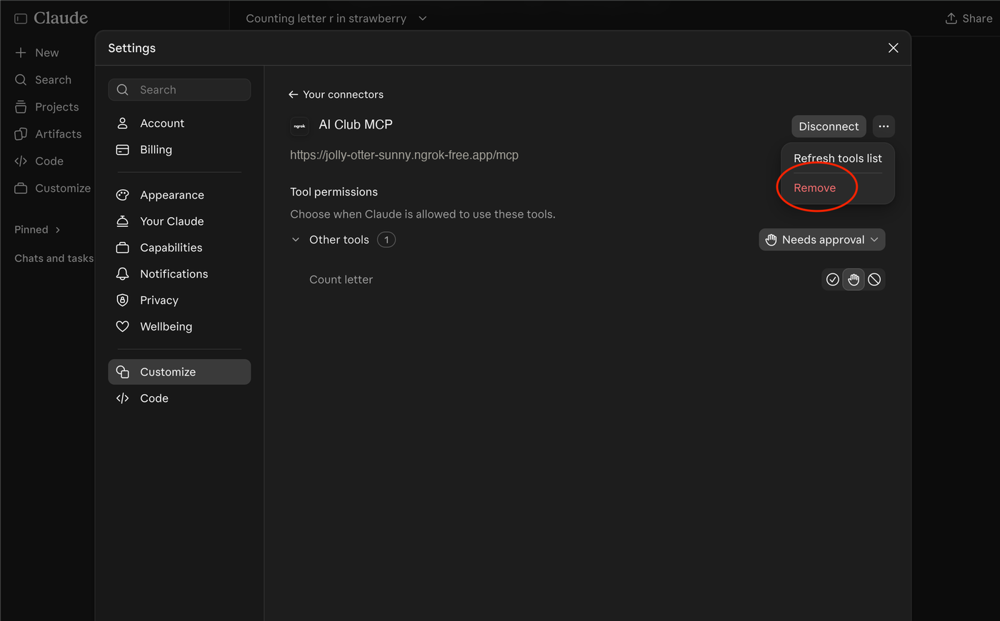

# Step 1: your first MCP server

In this step you finish a server with one small tool, `count_letter`, and
connect it to Claude on the web so the model calls it. There is no email data
yet; step 2 adds email tools to a new server built the same way.

Before you start, set up the Python environment from the
[README development setup](../../README.md#development-setup).

## Host, client, server and tool

MCP (Model Context Protocol) is a standard way for AI apps to use tools that
other people write. Four words come up again and again:

- A **host** is the app you chat in. In this project that is Claude on the
  web, at [claude.ai](https://claude.ai).
- The host runs an MCP **client**, which connects to an MCP **server**.
- A **server** is a program you write and run on your computer. It offers
  tools.
- A **tool** is a Python function that the model can ask to run. Each tool
  has three parts the model can see:
  - a **name**, such as `count_letter`;
  - a **description** in plain English, which the model reads to decide when
    the tool is useful;
  - **arguments** with types, such as "`text` is a piece of text and is
    required".

  The model never runs your code itself. When it decides a tool would help,
  it writes a request naming the tool and its arguments. The client sends the
  request to your server, your server runs the function, and the result goes
  back to the model, which uses it in its answer.

Tools let a model do things it cannot do alone. Language models are
unreliable at counting letters, because they read text in chunks rather than
letter by letter. `count_letter` gives an exact answer.

```text
You -> Claude (host and client) -> ngrok -> your MCP server -> count_letter("strawberry", "r") -> 3
```

ngrok carries messages from Claude's servers to your computer. The
[ngrok setup](ngrok-setup.md) guide explains it.

### What the messages look like: JSON

The client and the server exchange messages written in **JSON** (JavaScript
Object Notation). JSON is a plain-text format for structured data that
almost every programming language can read and write. It looks much like a
Python dictionary:

- `{ }` holds named fields, written as `"name": value`;
- `[ ]` holds a list of values;
- text goes in double quotes, and numbers and `true`/`false` do not.

Here is how `count_letter` looks in JSON, slightly shortened. When Claude
connects, your server describes each tool:

```json
{
  "name": "count_letter",
  "description": "Count how many times a letter appears in text, ignoring case.",
  "inputSchema": {
    "type": "object",
    "properties": {
      "text": {"type": "string"},
      "letter": {"type": "string"}
    },
    "required": ["text", "letter"]
  }
}
```

The `inputSchema` part is a JSON Schema: a description of which arguments the
tool takes and what type each one is. Here it says that both `text` and
`letter` are strings and both are required.

When you ask "How many r's are in strawberry?", Claude sends a call like
this:

```json
{"name": "count_letter", "arguments": {"text": "strawberry", "letter": "r"}}
```

Your server runs `count_letter(text="strawberry", letter="r")` and replies
with the result, `{"result": 3}`.

You never write this JSON yourself. The MCP Python SDK (the `mcp` package
this project installs) builds it from your Python function, as the next
section shows.

## Read the server

The whole server is [`src/email_mcp/hello_server.py`](../../src/email_mcp/hello_server.py).
Its tool is not finished yet; that is your first task:

```python
mcp = MCPServer("hello", instructions="Counts letters in text.")


@mcp.tool()
def count_letter(text: str, letter: str) -> int:
    """Count how many times a letter appears in text, ignoring case."""
    # TODO 1: count how many times `letter` appears in `text`.
    # (hints in the file)
    raise NotImplementedError("TODO 1: fill in count_letter in hello_server.py")
```

- `@mcp.tool()` registers the function. You write no JSON and no protocol
  code: the SDK takes the tool's name from the function name, its description
  from the docstring, and its arguments from the type hints. `text: str` and
  `letter: str` become two required string arguments.
- The return type `int` tells clients what the result looks like.
- Raising `ToolError` sends the model a readable error instead of crashing the
  server. The SDK also rejects calls with missing or wrongly typed arguments
  before your function runs.
- `raise NotImplementedError(...)` is a placeholder. It stops the tool with an
  error until you replace it with real code.

## Fill in TODO 1

Replace the `raise NotImplementedError(...)` line in `count_letter` with code
that does two things:

1. If `letter` is not exactly one character, raise
   `ToolError("letter must be exactly one character.")`. Use that exact
   message; the tests check it.
2. Otherwise, return how many times `letter` appears in `text`, ignoring upper
   and lower case. "Strawberry" with "R" should give 3.

Python pieces you can use:

- `len(letter)` is the number of characters in `letter`.
- `"Hello".lower()` returns `"hello"`.
- `"banana".count("a")` returns `3`.

Leave the decorator, the function's first line and the docstring as they are,
because they are what Claude sees.

## Check it works

### Why this project has tests

A test is a small program that runs your code and checks its answers
automatically. This project's tests use `unittest`, the testing module
built into Python. The step 1 tests start your server the same way Claude
does, call `count_letter` over a real MCP connection and check the results:
"strawberry" with "r" must give 3, and "rr" must give the exact error
message.

Tests are worth having because:

- they check in seconds what would take minutes to check by hand in Claude;
- they tell you exactly what is wrong, while Claude only shows
  "Error executing tool count_letter" when your code crashes;
- they keep checking old code while you change new code, so you notice when
  a change breaks something that used to work.

In this step the tests were written before your code. Writing the tests
first, then writing code until they pass, is called **test-driven
development** (TDD). It works in a short loop:

1. **Red:** run the tests and watch them fail. That shows the tests really
   check something.
2. **Green:** write the simplest code that makes them pass.
3. **Refactor:** tidy up the code, and rerun the tests to check nothing
   broke.

You will follow this loop for TODO 1 now and for TODO 2 in step 2.

### Run the tests

Run the step 1 tests from the repository root.

macOS/Linux:

```sh
.venv/bin/python -m unittest discover -s tests -p "test_hello_server.py" -v
```

Windows (PowerShell):

```powershell
.\.venv\Scripts\python.exe -m unittest discover -s tests -p "test_hello_server.py" -v
```

Until TODO 1 is filled in, both tests fail (red) with:

```text
AssertionError: TODO 1 not done yet: fill in count_letter in src/email_mcp/hello_server.py
```

Once your code is right, both tests pass (green). The error lines printed
while they run come from the calls that are meant to fail. If a test still
fails, read its last line: it names the check that failed, such as a wrong
count or a different error message.

Get both tests passing before you connect to Claude.

## Connect it to Claude

Claude on the web cannot start programs on your computer. Instead, your
server runs over HTTP, and an ngrok tunnel gives it a public address that
Claude can reach.

1. **Create a free Claude account.** If you do not have one, sign up at
   [claude.ai](https://claude.ai). A **free** account is all you need: free
   accounts can add a custom MCP connector, which is how Claude reaches your
   server.

2. **Set up ngrok, once.** If you have not yet, follow steps 1 to 4 of
   [ngrok setup](ngrok-setup.md): create a free ngrok account, save your
   authtoken and run the setup helper.

3. **Start the server.** In a terminal at the repository root:

   macOS/Linux:

   ```sh
   .venv/bin/mcp run src/email_mcp/hello_server.py:mcp --transport streamable-http
   ```

   Windows (PowerShell):

   ```powershell
   .\.venv\Scripts\mcp.exe run src/email_mcp/hello_server.py:mcp --transport streamable-http
   ```

   When it is ready, the last line it prints is
   `INFO:     Uvicorn running on http://127.0.0.1:8000 (Press CTRL+C to quit)`.
   The server is at `http://127.0.0.1:8000/mcp`. Keep this terminal open.
   Only one server can use port 8000, so stop any other server using it
   first.

4. **Start the tunnel.** In a second terminal at the repository root:

   macOS/Linux:

   ```sh
   .local/bin/ngrok http 8000 --config .local/ngrok.yml --traffic-policy-file .local/ngrok-policy.json
   ```

   Windows (PowerShell):

   ```powershell
   .\.local\bin\ngrok.exe http 8000 --config .local/ngrok.yml --traffic-policy-file .local/ngrok-policy.json
   ```

   Find the line that starts with **Forwarding**. It looks like this, with
   your own address in it:

   ```text
   Forwarding    https://jolly-otter-sunny.ngrok-free.app -> http://localhost:8000
   ```

   Copy the HTTPS address on the left of the arrow, here
   `https://jolly-otter-sunny.ngrok-free.app`. Yours is different. It may be
   a few words like this one, or groups of letters and numbers such as
   `https://1a2b-3c4d-5e6f.ngrok-free.app`, and it may end in
   `.ngrok-free.dev` instead. All of these work.

5. **Add `/mcp` to the end of the address.** ngrok never shows `/mcp`, so do
   not look for it in ngrok's output; you type it yourself. The result is
   your **connector URL**, for example:

   ```text
   https://jolly-otter-sunny.ngrok-free.app/mcp
   ```

   `/mcp` is the path where your server listens. Without it, Claude reaches
   your computer but not the server.

6. **Add a connector in Claude.** Free Claude accounts can have only one
   custom connector. If you already have one, remove it first, as in
   [Remove a connector](#remove-a-connector) below.

   1. At [claude.ai](https://claude.ai), click your name at the bottom left
      and choose **Settings**.

      

   2. Choose **Customize** and stay on the **Connectors** tab. Choose
      **+ Add**, then **Add custom connector**.

      

   3. Fill in the form, then add the connector:
      - Name: **AI Club MCP**. Everyone in the club uses this name,
        so guides and helpers can refer to it.
      - URL: your connector URL from step 5.
      - Sign in: choose **No sign in**.

   4. Your connector now appears in the list. Click **Connect** next to it.

      

7. **Turn off the Gmail connector.** If Gmail appears in your connector
   list, click it and choose **Disconnect** while you work on this project;
   you can connect it again afterwards. Otherwise, when you ask about
   emails, Claude may search your real Gmail account instead of your server.

8. **Start a chat with Haiku.** Close Settings and start a new chat. Click
   the model name under the message box (a new account shows Sonnet) and
   choose **Haiku**. Free accounts have tight usage limits, and Haiku uses
   less of them than the larger models, so you can test for longer. Check
   that **AI Club MCP** is enabled for the chat.

Keep both terminals open while you chat.

### Stop ngrok when you are not using it

Your ngrok address is public. While the tunnel runs, anyone who knows or
guesses it can call your server's tools. Press **Ctrl+C** in the ngrok
terminal when you finish testing and whenever you step away, and press
**Ctrl+C** in the server terminal when you are done. This server has no
private data, but later steps serve email, so build the habit now.

### When you come back

Start the server and the tunnel again (steps 3 and 4 above), then compare
the address ngrok shows with your connector's URL. If they differ, the
connector no longer reaches your server. Claude does not let you edit a
connector's URL, so remove **AI Club MCP** (next section) and add it
again with the new address plus `/mcp` (steps 5 and 6).

### Remove a connector

Remove a connector whenever you change connections: when your ngrok address
changes, when you switch to another step's server, or when you need the one
free custom connector slot for something else.

1. Click your name at the bottom left of [claude.ai](https://claude.ai),
   choose **Settings**, then **Customize**, and stay on the **Connectors**
   tab.
2. Click the connector, for example **AI Club MCP**.
3. Click the **...** button at the top right, then **Remove**.



## Try it

Start a new chat with Haiku and **AI Club MCP** enabled, and ask:

> Use the count_letter tool to count the letter r in "strawberry".

Claude may ask permission to call `count_letter`, then answers 3. Open the tool
call in the chat to see the arguments it sent (`{"text": "strawberry",
"letter": "r"}`) and the result the server returned.

Then ask for something the tool refuses:

> Use count_letter to count "rr" in "strawberry".

Claude should report the tool's error ("letter must be exactly one
character") rather than inventing a number.

Things to notice:

- Claude chose the arguments from your sentence. The schema built from the type
  hints told it which arguments exist and that both are text.
- The docstring is what Claude reads to decide when the tool is useful. Try
  changing it, restarting the server, and asking in a new chat without naming
  the tool. If Claude still shows the old description, remove and re-add the
  connector.

## If it does not work

- Claude reports "Error executing tool count_letter": TODO 1 is not finished,
  or your code raised an error other than `ToolError`. The SDK hides that
  error's details from Claude, so run the step 1 tests to see them. Restart
  the server after fixing the code: press Ctrl+C in its terminal and run the
  `mcp run` command again. The tunnel can keep running.
- Claude cannot reach the server: check that both terminals are still
  running, and that the connector URL ends in `/mcp` and matches the address
  ngrok shows now.
- "address already in use" when starting the server: another server is
  using port 8000. Stop it first.
- Claude searches your real Gmail account: it is using the Gmail connector
  instead of yours. Disconnect Gmail (step 7) and start a new chat.
- [ngrok setup](ngrok-setup.md#troubleshooting) has more fixes for ngrok
  problems.

## References

- [MCP Python SDK: first steps](https://py.sdk.modelcontextprotocol.io/get-started/first-steps/):
  host, client and server, and how a decorated function becomes a tool.
- [MCP Python SDK: handling errors](https://py.sdk.modelcontextprotocol.io/servers/handling-errors/):
  `ToolError`.
- [Claude: custom connectors using remote MCP](https://support.claude.com/en/articles/11175166-get-started-with-custom-connectors-using-remote-mcp):
  adding and removing a connector in Claude on the web.
- [JSON](https://www.json.org/json-en.html): the JSON format.
- [Python: unittest](https://docs.python.org/3/library/unittest.html): the
  testing module the tests use.
