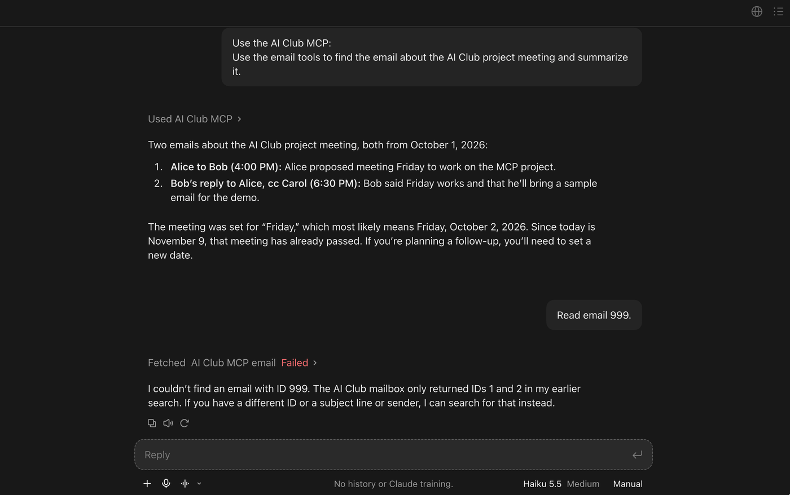

# Step 2: email tools

In this step you finish the email server. It has two tools that work
together: `search_emails` finds emails by words, and `get_email` reads one
email in full. `search_emails` is written for you; you write `get_email`. The
emails are three made-up messages kept in a Python list, so you can read
every one of them and check Claude's answers.

Finish [step 1](step1-first-server.md) first. This step reuses its Python
environment and its ngrok setup: if the `.venv` folder is missing, do the
[README development setup](../../README.md#development-setup); if `.local/` is
missing, do steps 1 to 4 of [ngrok setup](ngrok-setup.md).

## What is new since step 1

- **Two tools that work together.** The model has to search first, then use
  an `id` from the results to read an email.
- **Structured results.** Each tool returns a dictionary with named fields,
  not a single number, and tells clients what those fields are.
- **Limits on arguments.** `limit` must be between 1 and 10; the SDK rejects
  anything else before your code runs.
- **Data kept in its own file.** The server asks a store for emails, so a
  later step can swap the Python list for a database without touching the
  tools.

## Read the code

Two files make up the email server.

### `src/email_mcp/stores/list_store.py`

[`list_store.py`](../../src/email_mcp/stores/list_store.py) holds the emails and
the code that finds them.

- `MOCK_EMAILS` is a list of dictionaries, one per email. `to` and `cc` are
  lists because an email can have several recipients. Email 3 has an empty
  subject on purpose.
- `ListStore.search(query, limit)` splits the query into words and keeps an
  email when every word appears in its subject or body, ignoring case. It
  returns a short summary of each match, not the whole email.
- `ListStore.get(email_id)` returns one email, or `None` when no email has
  that id.

### `src/email_mcp/server.py`

[`server.py`](../../src/email_mcp/server.py) turns the store into MCP tools.

- `EmailSummary` and `Email` are `TypedDict`s: they name each field of a
  result and its type. The SDK turns them into an output schema, so clients
  know the shape of a result before calling the tool.
- `Annotated[str, Field(description=...)]` adds a description to an argument,
  and `Field(ge=1, le=10)` sets the smallest and largest allowed value. The
  model reads these when it decides what to send.
- `limit: ... = 5` gives `limit` a default, which makes it optional.
- `search_emails` raises `ToolError` when the query is blank. As in step 1, the
  model gets the message instead of the server crashing. Then it asks the
  store for matches and returns them.
- `get_email` is not finished yet; that is TODO 2.

## Fill in TODO 2

Open `src/email_mcp/server.py` and find `get_email`. Replace its
`raise NotImplementedError(...)` line with code that does three things:

1. Ask the store for the email with this id. `store.get(id)` returns the
   email, or `None` when no email has that id.
2. If there is no email, raise `ToolError(f"No email found for ID {id}.")`.
   Use that exact message; the tests check it.
3. Otherwise, return the email.

Use `search_emails`, just above it, as your model. It already raises a
`ToolError` when it cannot answer and returns what the store gives it; your
function follows the same pattern with `store.get` instead of
`store.search`. In Python, `x is None` checks whether `x` is `None`.

Return the store's dictionary as it is. The SDK checks it against `Email`, so
renaming or dropping a field makes the call fail.

## Check it works

Run the email tests from the repository root. They start the server the way a
host does, search, read each email, and check the errors.

macOS/Linux:

```sh
.venv/bin/python -m unittest discover -s tests -p "test_server.py" -v
```

Windows (PowerShell):

```powershell
.\.venv\Scripts\python.exe -m unittest discover -s tests -p "test_server.py" -v
```

This is the same test-driven loop as in step 1. Until TODO 2 is filled in,
all three tests fail (red) with:

```text
AssertionError: TODO 2 not done yet: fill in get_email in src/email_mcp/server.py
```

Once your code is right, all three pass (green). As in step 1, the error lines printed
while they run come from calls that are meant to fail. Finish this section
before connecting to Claude.

## Connect it to Claude

You connect the email server the same way as the step 1 server, through
ngrok.

1. **Stop the step 1 server.** Press **Ctrl+C** in its terminal. Only one
   server can use port 8000. If your ngrok tunnel is still running, leave it
   running: it forwards to whatever server uses port 8000, so its address
   stays the same.

2. **Start the email server.** In that terminal, at the repository root:

   macOS/Linux:

   ```sh
   .venv/bin/mcp run src/email_mcp/server.py:mcp --transport streamable-http
   ```

   Windows (PowerShell):

   ```powershell
   .\.venv\Scripts\mcp.exe run src/email_mcp/server.py:mcp --transport streamable-http
   ```

3. **Start the tunnel if it is not running.** In a second terminal at the
   repository root:

   macOS/Linux:

   ```sh
   .local/bin/ngrok http 8000 --config .local/ngrok.yml --traffic-policy-file .local/ngrok-policy.json
   ```

   Windows (PowerShell):

   ```powershell
   .\.local\bin\ngrok.exe http 8000 --config .local/ngrok.yml --traffic-policy-file .local/ngrok-policy.json
   ```

   Find the line that starts with **Forwarding** and copy the HTTPS address
   on the left of the arrow, such as
   `https://jolly-otter-sunny.ngrok-free.app`.

4. **Build your connector URL.** Type `/mcp` at the end of ngrok's address;
   ngrok never shows `/mcp` itself. For example:

   ```text
   https://jolly-otter-sunny.ngrok-free.app/mcp
   ```

5. **Remove the step 1 connector.** You are changing connections, so remove
   **AI Club MCP** first, as in step 1's
   [Remove a connector](step1-first-server.md#remove-a-connector). Claude
   remembers each connector's tools, and a fresh connector makes it read the
   email server's tools.

6. **Add the connector again.** Add **AI Club MCP** exactly as in
   step 6 of [step 1](step1-first-server.md#connect-it-to-claude): **+ Add**,
   **Add custom connector**, the same name, your connector URL from step 4,
   **No sign in**, then **Connect**.

   Keep Gmail disconnected, as in step 1. Otherwise Claude may search your
   real Gmail account instead of your server.

7. **Start a chat with Haiku.** Start a new chat, choose **Haiku** under the
   message box, and check that **AI Club MCP** is enabled for the
   chat.

Keep both terminals open while you chat.

### Stop ngrok when you are not using it

Your ngrok address is public. While the tunnel runs, anyone who knows or
guesses it can call your tools and read every email this server holds.
These emails are made up, but later steps use real ones, so press **Ctrl+C**
in the ngrok terminal when you finish testing and whenever you step away,
and press **Ctrl+C** in the server terminal when you are done.

### When you come back

Start the email server and the tunnel again (steps 2 and 3 above), then
compare the address ngrok shows with your connector's URL. If they differ,
the connector no longer reaches your server. Claude does not let you edit a
connector's URL, so remove **AI Club MCP** and add it again with
the new address plus `/mcp` (steps 4 to 6 above).

## Try it

Start a new chat with Haiku and **AI Club MCP** enabled, and ask:

> Use the email tools to find the email about the AI Club project meeting and summarize it.

Claude should call `search_emails` (for example with
`{"query": "AI Club project meeting"}`), then `get_email` with an id from the
results. Check the answer against `MOCK_EMAILS`: Alice asks Bob to meet on
Friday to work on the MCP project, and Bob replies that Friday works, copying
Carol.

Then try:

> Which email has no subject, and who sent it?

Claude should answer that Carol sent the email with no subject.

Finally, ask for an email that does not exist:

> Read email 999.

This prompt should not return an email, because there is no email with id
999. Claude should report the tool's error ("No email found for ID 999.")
instead of inventing one.

Here is what the first and last prompts look like in a real chat:



Things to notice:

- Claude used two tools in a row and passed the `id` from one to the other.
  Nothing in the server tells it to; it worked that out from the tool
  descriptions.
- Open a tool call to see the structured result the server returned, with the
  field names from `EmailSummary` or `Email`.

## Try changing it

1. Add a fourth email to `MOCK_EMAILS` with a new id (4) and a subject of your
   choice.
2. Restart the server: press Ctrl+C in its terminal and run the `mcp run`
   command again. The tunnel can keep running.
3. Ask Claude to find your email.

The tests check the original three emails, so a search test can fail if your
new email contains the word "friday". That failure is the test doing its job.

## If it does not work

- Claude reports "Error executing tool get_email" for an id that exists:
  TODO 2 is not finished, or your code raised an error other than
  `ToolError` or returned a different shape than `Email`. Run the email
  tests to see the details, then restart the server.
- Claude cannot reach the server: check that both terminals are still
  running, and that the connector URL ends in `/mcp` and matches the address
  ngrok shows now.
- Claude answers without calling a tool: ask it to "use the email tools".
- Claude searches your real Gmail account: it is using the Gmail connector
  instead of yours. Disconnect Gmail, as in step 1, and start a new chat.
- Claude only offers `count_letter`: it still has the step 1 tool list.
  Remove **AI Club MCP** and add it again (steps 5 and 6 above).
- "address already in use" when starting the server: another server, such
  as the step 1 server, is using port 8000. Stop it first.
- [ngrok setup](ngrok-setup.md#troubleshooting) has more fixes for ngrok
  problems.

## References

- [MCP Python SDK: structured output](https://py.sdk.modelcontextprotocol.io/servers/structured-output/):
  `TypedDict` results and how a returned list is wrapped as `{"result": [...]}`.
- [MCP Python SDK: richer schemas with Field](https://py.sdk.modelcontextprotocol.io/servers/tools/#richer-schemas-with-field):
  argument descriptions and bounds.
- [MCP Python SDK: handling errors](https://py.sdk.modelcontextprotocol.io/servers/handling-errors/):
  `ToolError`.
- [Python: TypedDict](https://docs.python.org/3/library/typing.html#typing.TypedDict).
